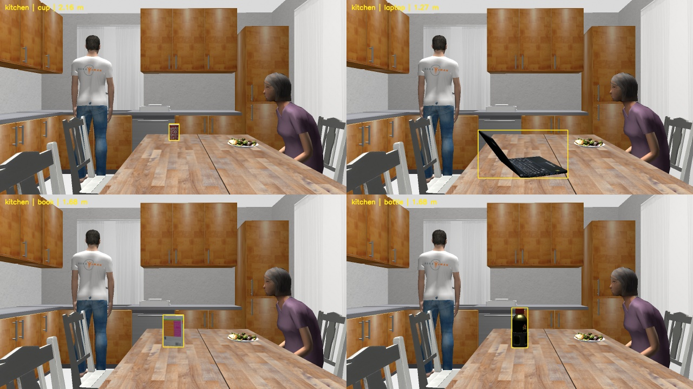
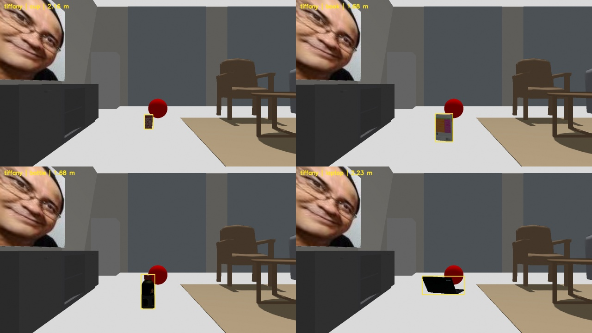
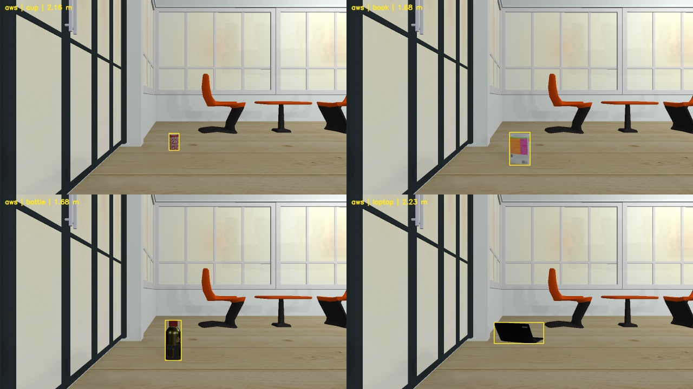

# Kiểm thử hiệu chỉnh Metric3D v2 trên ba phòng Gazebo

**Hiệu chỉnh từ Kitchen giảm sai số trên cả hai phòng độc lập, với mức cải thiện khác nhau.** Với hệ số tỷ lệ B đã chọn trước, trung vị XY giảm từ **67,0 xuống 22,4 cm** ở AWS và từ **132,1 xuống 108,5 cm** ở Tiffany. AWS đạt cả ba ngưỡng định lượng trên 7 detection đủ điều kiện. Tiffany trượt cả ba ngưỡng dù mọi mẫu đủ điều kiện đều tốt lên. Batch chưa đủ cơ sở để áp dụng một hệ số chung vào production.

## Tập hiệu chỉnh và thiết kế holdout

- Fit từ 27 điều kiện Kitchen đã lưu, mỗi điều kiện có tổng trọng số bằng nhau. Kiểm tra chéo giữ lại từng nhóm khoảng cách cho MAE theo điều kiện lần lượt 0,421 m (A), 0,096 m (B), 0,137 m (C). Chọn B trước khi đánh giá holdout. Tái lập đúng các hệ số và kiểm tra SHA-256 của 78 file huấn luyện, 50 mục baseline cũ kể cả archive, 57 file thu/thiết kế và 96 file output inference. [Kiểm tra toàn vẹn](verification.json) · [Các fold Kitchen](kitchen_group_cv.csv)
- A giữ nguyên Z đại diện. B dùng 1,3720333574 × Z. C dùng 1,1586573968 × Z + 0,2479224122 m. Khóa lúc 18:47:42 ngày 10/11/2026 (UTC+7), SHA-256 `e7307ac5818f43221b4a9a7aae647afafa5ba720ee3835c4282acf3139f9a511`. Giới hạn cố định 0,100001–9,999999 m, không mẫu hay pixel được chấm nào chạm giới hạn. [Tệp khóa](locked.json)
- Thu 48 khung mới, 16 mỗi phòng. Mỗi chai, cốc, laptop, sách được đặt lần lượt ở bốn cặp khoảng cách axial danh định và yaw tương đối (1,27 m / 20°, 1,68 m / 65°, 2,16 m / 20°, 2,23 m / 65°). Một khung cho mỗi điều kiện, camera đứng yên trong từng phòng, thay vị trí/hướng vật theo thứ tự xáo trộn cố định. Kitchen dùng vị trí camera mới. Các cặp khoảng cách và góc chưa tạo thành thiết kế đầy đủ, nên bảng theo nhóm có giá trị mô tả.
- Rig LOC3D dùng 1280×720, HFOV 70°, fx = fy = 914,014701 px, cx = 640 px, cy = 360 px và offset optical 0,05 m. Metric3D v2 ViT-Small giữ input reference cao × rộng 616×1064. Đã kiểm tra SHA-256 của cả ba checkpoint từ manifest. YOLOE, prompts, bộ lọc và hàm chiếu production được giữ nguyên. Model nhận RGB và intrinsics cần thiết.
- Camera base (x, y, z, yaw) theo world riêng lần lượt là Kitchen (−1,67, −0,35, 1,11, 0,015 rad), Tiffany (−1,85, 1,38, 0,46, 0), AWS (−2,00, 0,75, 0,46, π/2). Kitchen đặt vật trên mặt bàn, hai phòng mới đặt vật trên sàn. RGB, depth axial, panoptic và CameraInfo cùng timestamp. Pan có lệch timestamp 0 ms. Pose rig/vật tĩnh được kiểm tra ở hai phía timestamp để lập TF. [QA capture](capture_qa.json) · [Cấu hình và nguồn world](rooms.json)

## Kết quả A/B/C

MAE, bias, XY và XYZ tính bằng mét. Depth đại diện được chấm với median GT axial trên phần mask YOLOE đã erode giao với GT instance, dùng chung các pixel hợp lệ. XY/XYZ so với tâm hộp bao mesh từ pose thực tế của đúng instance. A/B/C dùng cùng UV, mask, K và TF. Cột XY/XYZ lần lượt là trung bình / trung vị / P90.

| Phòng | Phép thử | n | Depth MAE | AbsRel | Bias | XY | XYZ |
| --- | --- | ---: | ---: | ---: | ---: | --- | --- |
| Kitchen | A | 9 | 0.413 | 25.0% | -0.413 | 0.465 / 0.478 / 0.614 | 0.469 / 0.481 / 0.617 |
| Kitchen | B | 9 | 0.071 | 4.6% | 0.051 | 0.078 / 0.070 / 0.154 | 0.080 / 0.072 / 0.157 |
| Kitchen | C | 9 | 0.071 | 4.6% | 0.033 | 0.082 / 0.090 / 0.125 | 0.086 / 0.090 / 0.125 |
| Tiffany Living Room | A | 8 | 1.261 | 70.6% | -1.261 | 1.311 / 1.321 / 1.610 | 1.337 / 1.343 / 1.628 |
| Tiffany Living Room | B | 8 | 1.063 | 59.6% | -1.063 | 1.113 / 1.085 / 1.379 | 1.134 / 1.103 / 1.394 |
| Tiffany Living Room | C | 8 | 0.929 | 51.3% | -0.929 | 0.979 / 0.972 / 1.264 | 0.997 / 0.988 / 1.277 |
| AWS Small House | A | 7 | 0.587 | 34.3% | -0.587 | 0.650 / 0.670 / 0.769 | 0.661 / 0.683 / 0.776 |
| AWS Small House | B | 7 | 0.163 | 9.8% | -0.163 | 0.227 / 0.224 / 0.277 | 0.229 / 0.225 / 0.282 |
| AWS Small House | C | 7 | 0.160 | 8.8% | -0.158 | 0.222 / 0.263 / 0.293 | 0.224 / 0.266 / 0.295 |

| Phòng | B giảm trung vị XY | C giảm trung vị XY | Mẫu tốt lên/xấu đi so với A | AbsRel ≤15%, trung vị XY ≤0,30 m và P90 XY ≤0,60 m |
| --- | ---: | ---: | --- | --- |
| Kitchen | 40.8 cm (85.3%) | 38.8 cm (81.1%) | 9/0 cho cả B và C | PASS cả B và C |
| Tiffany Living Room | 23.6 cm (17.9%) | 34.9 cm (26.4%) | 8/0 cho cả B và C | FAIL cả B và C |
| AWS Small House | 44.6 cm (66.5%) | 40.7 cm (60.7%) | 7/0 cho cả B và C | PASS cả B và C |

Số mẫu tốt lên/xấu đi giống nhau theo depth tuyệt đối đại diện, XY và XYZ. C giảm trung vị XY nhiều nhất ở Tiffany. B giảm trung vị XY nhiều nhất ở Kitchen và AWS. C có P90 XY thấp hơn ở Kitchen và MAE depth đại diện thấp hơn nhẹ ở AWS. Lựa chọn trước holdout vẫn là B.

Đối chiếu cùng pixel hợp lệ theo thứ tự MAE (m) / AbsRel / bias (m), mỗi khung có trọng số như nhau. Đây là phép chấm bổ sung trên depth map.

| Phòng | A | B | C |
| --- | --- | --- | --- |
| Kitchen | 0.403 / 24.4% / -0.381 | 0.133 / 7.9% / 0.097 | 0.117 / 7.1% / 0.071 |
| Tiffany Living Room | 1.260 / 70.5% / -1.260 | 1.061 / 59.6% / -1.059 | 0.928 / 51.3% / -0.926 |
| AWS Small House | 0.576 / 33.8% / -0.573 | 0.178 / 10.6% / -0.143 | 0.168 / 9.4% / -0.142 |

Khoảng cách từ pixel GT bề mặt gần UV đại diện đến tâm mesh trung bình là 6,2/6,7 cm (XY/XYZ) ở Kitchen, 6,3/6,4 cm ở Tiffany và 7,0/7,0 cm ở AWS. Chênh lệch hình học này được báo cáo riêng để tránh cộng trùng độ lớn vector. Phép đo vô hướng trên CPython cho trung vị 149 ns (A), 499 ns (B), 495 ns (C), gồm overhead vòng lặp. Chênh lệch khoảng 0,35 µs mỗi Z, chưa tính suy luận và I/O. [Đo thời gian](scalar_timing.json)

### Phạm vi detection

| Phòng | Thu / có instance GT nhìn thấy | Đủ QA ảnh | Đúng instance và lớp | Sai lớp trên instance | Bỏ sót detection đúng | Chấm tọa độ |
| --- | ---: | ---: | ---: | ---: | ---: | ---: |
| Kitchen | 16/16 | 16 | 9/16 (56,3%) | 2 | 7 | 9 |
| Tiffany | 16/16 | 15 | 9/16 (56,3%) | 0 | 7 | 8 |
| AWS | 16/16 | 15 | 8/16 (50,0%) | 0 | 8 | 7 |

Ghép instance nếu IoU mask ≥0,50 và đúng lớp. Cột bỏ sót gồm cả mẫu chỉ có detection sai lớp. Kitchen có hai laptop được gọi là `chair` (IoU 0,940 và 0,855). Cả 12 khung sách thiếu detection đúng. Mỗi phòng ngoài có một laptop 1,27 m / 20° chạm mép dưới, vẫn tính trong coverage và được đánh dấu riêng. Hai detection đó không tham gia phép chấm tọa độ. Vật nền thiếu instance GT nằm ngoài phạm vi chấm recall.

Các mẫu định vị gồm chai/cốc/laptop lần lượt 4/3/2 ở Kitchen, 4/3/1 ở Tiffany và 4/1/2 ở AWS. Không có mẫu đã chấm nào xấu đi so với A. Chai ở 2,16 m / 20° cho phép đối chiếu cùng mesh và điều kiện danh định. GT bề mặt xấp xỉ 2,120 m ở cả ba phòng, còn A cho 1,548 m ở Kitchen, 1,391 m ở AWS và 0,589 m ở Tiffany. Sau B, Tiffany vẫn chỉ lên 0,808 m. Chênh lệch này có ở depth axial trước khi chiếu về world. Thiết kế chưa tách được tác động của bố cục, ánh sáng và vị trí rig.

| Phòng | Detection | A/B/C từng mẫu | Theo vật, khoảng cách và góc |
| --- | --- | --- | --- |
| Kitchen | [CSV](holdout_kitchen/detection.csv) | [CSV](holdout_kitchen/scores.csv) | [CSV](holdout_kitchen/by_condition.csv) |
| Tiffany | [CSV](holdout_tiffany/detection.csv) | [CSV](holdout_tiffany/scores.csv) | [CSV](holdout_tiffany/by_condition.csv) |
| AWS | [CSV](holdout_aws/detection.csv) | [CSV](holdout_aws/scores.csv) | [CSV](holdout_aws/by_condition.csv) |

## World, ảnh render và kiểm tra

| Hạng mục | Trạng thái | Bằng chứng |
| --- | --- | --- |
| Tiffany nạp world gốc và bản sao trên Harmonic | PASS | Commit `65979b3c8ae390047e58625709bf303ddbcd5c17`. World `src/hexapod_ws/worlds/living_room.sdf`. Apache-2.0 khai báo trong `package.xml`. Checkout không có file license riêng ở root. [Repo Tiffany](https://github.com/SENAI4LIFE/tiffany_gazebo) · [Services](original_tiffany_services.txt) |
| AWS nạp world gốc và bản sao trên Harmonic | PASS | Commit `e50bde2df22004f6eb231932fc6b5d4c321b8818` từ `jazzy`. World `small_house.world`, package Apache-2.0, world/models MIT-0. Cảnh báo SDF cũ `pose frame=""` và quán tính không hợp lệ, sensors vẫn thu đủ. [Package EasyNav](https://github.com/EasyNavigation/easynav_playgrounds/tree/jazzy/playground_kobuki/easynav_playground_kobuki_worlds) · [Services](original_aws_services.txt) · [Log AWS](original_aws.log) |
| RGB, texture, nhãn instance, axial depth, CameraInfo và TF | PASS | 48/48 bộ cùng timestamp, pose đã đối chiếu, GT depth phù hợp với vị trí đặt. Texture vật mục tiêu hiện trong ảnh. |
| Toàn bộ vật nằm trong khung | FAIL | 46/48 đủ QA khung, laptop gần bị cắt ở mỗi phòng ngoài. |
| Ngưỡng định lượng cho B/C | PASS Kitchen và AWS, FAIL Tiffany | Đánh giá trên 24 mẫu đúng instance đủ điều kiện, coverage toàn pipeline vẫn 50–56%. |
| Camera thật hoặc quay rig 360° | NOT TESTED | Batch dùng một vị trí rig mỗi phòng với bốn mesh. |
| Regression LOC3D / YOLOE | PASS | 58/58 pytest trên WSL và 79/79 unittest trên Windows. [LOC3D](regression_loc3d_wsl_final.log) · [YOLOE](regression_yoloe_final.log) |

Ảnh RGB do Gazebo Harmonic render. Khung vàng là bbox của instance GT.

### Kitchen

### Tiffany Living Room

### AWS Small House

## Một phép thử tiếp theo

Giữ nguyên B và lặp lại đúng các cặp khoảng cách/góc ở Tiffany với một vị trí camera mới được định trước, đủ khoảng lùi để laptop không cắt mép. Giữ mesh, texture, ánh sáng, intrinsics và model. Đối chiếu cùng pixel GT và XY để xem bias lớn có lặp lại ở bố trí khác trong cùng world.

## Lệnh và artifact

Các lệnh chính trong batch dưới đây rút gọn đường dẫn tuyệt đối bằng biến `BATCH`. WSL chạy từ `/mnt/d/loc3d_ws`, trừ các lệnh Git của hai repo chạy trong thư mục batch. Tệp khóa chỉ ghi một lần. Dùng `verify.py` để kiểm tra lại mà không ghi đè fit.

~~~bash
git clone https://github.com/SENAI4LIFE/tiffany_gazebo.git tiffany
git clone --branch jazzy https://github.com/EasyNavigation/easynav_playgrounds.git easynav
git -C tiffany rev-parse HEAD
git -C easynav rev-parse HEAD
bash "$BATCH/smoke.sh"
/usr/bin/python3 "$BATCH/prepare_rooms.py"
bash "$BATCH/capture_continuation.sh" tiffany aws kitchen
PYTHONDONTWRITEBYTECODE=1 TORCH_HOME="$BATCH/cache" YOLO_CONFIG_DIR="$BATCH/batch_config" \
  XDG_CACHE_HOME="$BATCH/cache" TMPDIR="$BATCH/tmp" .venv/bin/python "$BATCH/evaluate_rooms.py" \
  tiffany=holdout_tiffany aws=holdout_aws kitchen=holdout_kitchen
PYTHONDONTWRITEBYTECODE=1 TORCH_HOME="$BATCH/cache" YOLO_CONFIG_DIR="$BATCH/batch_config" \
  XDG_CACHE_HOME="$BATCH/cache" TMPDIR="$BATCH/tmp" .venv/bin/python -m pytest -q -s \
  -p no:cacheprovider --basetemp="$BATCH/tmp/regression" tests
~~~

~~~powershell
D:\yoloe_test\.venv\Scripts\python.exe "$batch\qa.py"
D:\yoloe_test\.venv\Scripts\python.exe "$batch\verify.py"
D:\yoloe_test\.venv\Scripts\python.exe -m unittest discover -s tests
~~~

`unittest` chạy từ `D:\yoloe_test`, với `TEMP`/`TMP` trỏ vào batch. Lần gọi pytest bằng venv Windows thiếu module, đã chạy lại thành công bằng venv LOC3D trên WSL mà không cài dependency.

- [Tổng hợp JSON](holdout_summary.json), [QA](capture_qa.json), [hash capture](capture_hashes.json), [hash inference và tái lập fit](verification.json), [log inference](evaluate_rooms.log), [log fit ban đầu](fit.log).
- Script batch gồm `fit.py`, `prepare_rooms.py`, `collect.py`, `smoke.sh`, `capture_continuation.sh`, `qa.py`, `evaluate_rooms.py` và `verify.py`.
- Mỗi thư mục `holdout_*` lưu thiết kế, index timestamp/pose/TF, CSV, ảnh và log thu. Các gói NPZ RGB/depth/panoptic/K, predicted depth và mask YOLOE, bản sao SDF, checkpoint và checkout bên thứ ba nằm cục bộ. Báo cáo, bảng, ảnh, mã đánh giá và hash được đưa lên GitHub.
