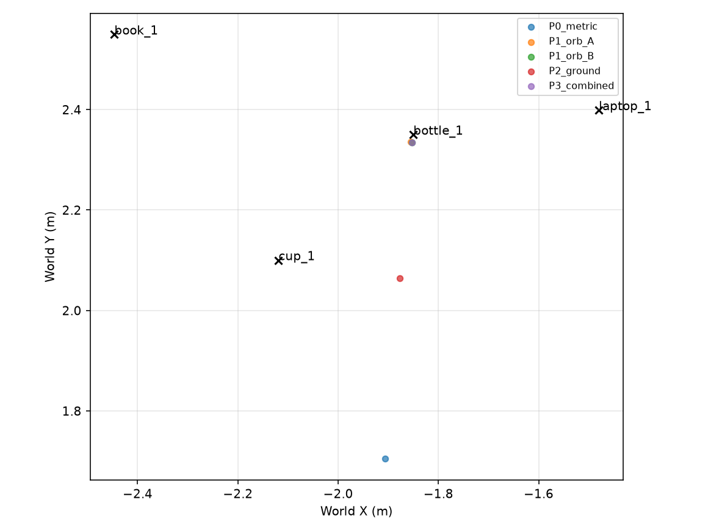
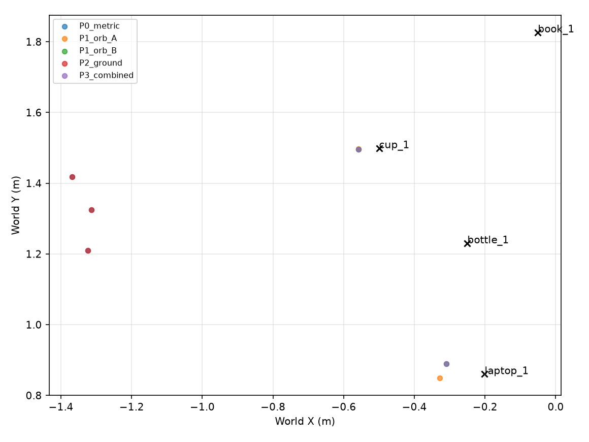

# ORB và Metric3D trên AWS Small House và Tiffany Living Room

AWS Small House có 5/15 lượt nhận diện đúng. Confirmed P0 → P3 là 1/4 → 1/4. XY trung vị P0 64.8 cm (n=1), P3 1.5 cm (n=1), AbsRel 32.7% → 1.3%.
Tiffany Living Room có 9/16 lượt nhận diện đúng. Confirmed P0 → P3 là 3/4 → 2/4. XY trung vị P0 106.8 cm (n=3), P3 8.5 cm (n=2), AbsRel 66.5% → 10.0%.

Hai lượt mới chạy ROS đủ 18 stop/phòng. Kết quả ORB, sàn và fallback được replay trên cùng dữ liệu đã thu. Camera giữ 1280×720 và FOV 70°, fx=fy=914,014701 px, cx=640, cy=360. Metric3D ViT-Small giữ 616×1064. Các ngưỡng ORB giống từng byte với Kitchen, đã khóa trước khi chụp ảnh đánh giá. Số đo Kitchen ở bảng dưới lấy từ holdout đã chạy trước. Hai phòng mới có lượt thu và inference mới.

| World | Phương pháp | Confirmed | XY TV (cm) | XY P90 (cm) | XYZ TV (cm) | Depth AbsRel | Đủ tiêu chí đồ án |
| --- | --- | --- | --- | --- | --- | --- | --- |
| Kitchen holdout trước | P0 Metric3D | 3/4 | 39.7 | 45.4 | 39.8 | 20.0% | FAIL |
| Kitchen holdout trước | ORB-A thuần | 3/4 | 5.1 | 6.7 | 5.1 | 0.9% | FAIL |
| Kitchen holdout trước | ORB-B thuần | 3/4 | 5.1 | 5.9 | 5.2 | 1.0% | FAIL |
| Kitchen holdout trước | P2 Sàn + dự phòng | 3/4 | 39.7 | 45.4 | 39.8 | 20.0% | FAIL |
| Kitchen holdout trước | P3 Kết hợp | 3/4 | 5.1 | 5.9 | 5.2 | 1.0% | FAIL |
| Kitchen holdout trước | ORB theo nhu cầu | 2/4 | 15.1 | 15.9 | 15.4 | 7.7% | FAIL |
| AWS Small House | P0 Metric3D | 1/4 | 64.8 | 64.8 | 65.3 | 32.7% | FAIL |
| AWS Small House | ORB-A thuần | 1/4 | 1.5 | 1.5 | 3.6 | 1.4% | FAIL |
| AWS Small House | ORB-B thuần | 1/4 | 1.5 | 1.5 | 2.0 | 1.3% | FAIL |
| AWS Small House | P2 Sàn + dự phòng | 1/4 | 28.7 | 28.7 | 28.8 | 14.2% | FAIL |
| AWS Small House | P3 Kết hợp | 1/4 | 1.5 | 1.5 | 2.0 | 1.3% | FAIL |
| AWS Small House | ORB theo nhu cầu | 1/4 | 13.4 | 13.4 | 13.4 | 5.4% | FAIL |
| Tiffany Living Room | P0 Metric3D | 3/4 | 106.8 | 115.4 | 107.9 | 66.5% | FAIL |
| Tiffany Living Room | ORB-A thuần | 2/4 | 9.3 | 12.0 | 10.3 | 2.3% | FAIL |
| Tiffany Living Room | ORB-B thuần | 2/4 | 8.5 | 10.7 | 8.8 | 2.3% | FAIL |
| Tiffany Living Room | P2 Sàn + dự phòng | 3/4 | 106.8 | 115.4 | 107.9 | 66.5% | FAIL |
| Tiffany Living Room | P3 Kết hợp | 2/4 | 8.5 | 10.7 | 8.8 | 10.0% | FAIL |
| Tiffany Living Room | ORB theo nhu cầu | 0/4 | KHÔNG CÓ KẾT QUẢ | KHÔNG CÓ KẾT QUẢ | KHÔNG CÓ KẾT QUẢ | 29.7% | FAIL |

Tiêu chí đồng thời gồm AbsRel ≤15%, XY trung vị ≤30 cm, XY P90 ≤60 cm, recall confirmed ≥80%, precision có nhãn ≥85% và duplicate ≤10%. Với bốn vật, confirmed 3/4 tương ứng 75%. Sai số tọa độ được báo cùng số vật có kết quả, các vật thất bại vẫn ở mẫu số recall. Precision chỉ áp dụng vùng có instance GT. Các vật nội thất khác chưa có GT được ghi ngoài phạm vi.

Đối chứng cuối SQLite trên các vật có kết quả ở cả P0 và P3. Các số trung vị trước/sau ở đây dùng cùng tập vật.

| World | Số vật ghép cặp | P0 XY TV (cm) | P3 XY TV (cm) | Tốt / xấu hơn |
| --- | --- | --- | --- | --- |
| Kitchen holdout trước | 3 | 39.7 | 5.1 | 3/0 |
| AWS Small House | 1 | 64.8 | 1.5 | 1/0 |
| Tiffany Living Room | 2 | 102.4 | 8.5 | 2/0 |

[Từng vật ghép cặp](paired_final.csv)

## Điều kiện thử và dữ liệu đầu vào

Các bộ calibration AWS/Tiffany cũ thay vị trí hoặc vật giữa các lần chụp, nên chưa cung cấp các cặp nhìn cùng vật đứng yên cần cho phép thử này. Batch mới đặt đồng thời chai, cốc, laptop và sách, cố định vật trong suốt một lượt 360°. Mỗi phòng dùng vị trí camera riêng đã được xác minh ở batch trước, cao 0,36 m. Kitchen holdout trước dùng camera cao 1,10 m và vật trên bàn. Vì vậy, bảng giữa ba world phản ánh cả điều kiện bố trí/camera, chưa cô lập ảnh hưởng riêng của world.

| Phòng | Camera base XYZ (m) | Yaw base | Hướng khu vực vật | Cao độ sàn (m) |
| --- | --- | --- | --- | --- |
| AWS | −2,00 / 0,75 / 0,36 | 0° | Bắc, quanh 90° | 0,006 |
| Tiffany | −1,85 / 1,38 / 0,36 | 0° | Đông, quanh 0° | 0,003 |

Broadcaster production hỗ trợ base song song trục world. Bản sao rig đặt yaw base 0°, còn các góc quét bao phủ toàn phòng. TF được lấy đúng stamp và kiểm với yaw joint, pose rig được so với Gazebo. Bốn asset và texture dùng lại từ Kitchen, đặt trên sàn với AABB không chồng nhau. Tâm mesh tính theo phép biến đổi pose riêng của từng phòng. Cao độ sàn lấy từ cấu hình scene, không fit theo GT.

AWS ban đầu dùng bước physics 5 ms. Lượt đầu ghi được stop 0, sau đó pan dao động với vận tốc joint đo tới khoảng ±1111 rad/s. Đã dừng lượt này và giữ dữ liệu/log trong aws_initial_unstable. Bản sao AWS được đổi bước physics thành 1 ms giống Kitchen. Các ngưỡng nhận diện, ORB, association và camera được giữ như đã khóa. Tiffany vốn dùng 1 ms. Frozen inputs được ghi lại trước các lượt đánh giá hợp lệ. Nguồn world và asset gốc giữ nguyên. Chỉ kết quả lượt đủ 18 stop được chấm.

ORB-A lấy median XYZ của điểm bề mặt. ORB-B lấy median optical Z rồi chiếu qua centroid mask RGB đã erode bằng K/TF. Sàn dùng cùng bộ tìm vùng floor RGB và gate đã thử ở Kitchen. P3 chọn ORB-B → sàn → Metric3D gốc theo các gate đó. GT panoptic/depth và tâm mesh chỉ dùng để chấm. Oracle sàn được ghi riêng. Không dùng hệ số hiệu chỉnh được fit ở Kitchen hoặc từng phòng trong P0/P3.

[Thiết kế](PLAN.md) · [Frozen inputs](frozen.json) · [QA](verification.json) · [Pose AWS](aws/layout.json) · [Pose Tiffany](tiffany/layout.json) · [Nguồn và commit world](../metric3d_crossworld_fullbatch_20261110_222348/world_sources.json)

## AWS Small House · scan_1794363992

RunScan đủ 18/18 trong **185.2 s**. YOLOE 12.0 s, Metric3D 79.9 s, hậu xử lý 0.9 s. Yaw lệch tối đa 0.085°, độ lệch stamp joint tối đa 0.0 ms. Có 25 observations. RGB phát hiện đúng 5/15 lượt thấy vật (33.3%), bỏ sót 10, sai lớp 0, cắt biên 0.

| Vật | Thấy | Đúng | Sai lớp | Bỏ sót | Cắt biên | Obs hợp lệ |
| --- | --- | --- | --- | --- | --- | --- |
| Chai | 4 | 3 | 0 | 1 | 0 | 3 |
| Cốc | 4 | 2 | 0 | 2 | 0 | 2 |
| Laptop | 4 | 0 | 0 | 4 | 0 | 0 |
| Sách | 3 | 0 | 0 | 3 | 0 | 0 |

Sai số cuối SQLite tính theo tâm mesh. Mỗi ô ghi XY / XYZ theo cm.

| Phương pháp | Chai | Cốc | Laptop | Sách | Xác nhận đúng |
| --- | --- | --- | --- | --- | --- |
| P0 Metric3D | 64.8 / 65.3 | KHÔNG CÓ KẾT QUẢ | KHÔNG CÓ KẾT QUẢ | KHÔNG CÓ KẾT QUẢ | 1/4 |
| ORB-A thuần | 1.5 / 3.6 | KHÔNG CÓ KẾT QUẢ | KHÔNG CÓ KẾT QUẢ | KHÔNG CÓ KẾT QUẢ | 1/4 |
| ORB-B thuần | 1.5 / 2.0 | KHÔNG CÓ KẾT QUẢ | KHÔNG CÓ KẾT QUẢ | KHÔNG CÓ KẾT QUẢ | 1/4 |
| P1 ORB-A + dự phòng | 1.5 / 3.6 | KHÔNG CÓ KẾT QUẢ | KHÔNG CÓ KẾT QUẢ | KHÔNG CÓ KẾT QUẢ | 1/4 |
| P1 ORB-B + dự phòng | 1.5 / 2.0 | KHÔNG CÓ KẾT QUẢ | KHÔNG CÓ KẾT QUẢ | KHÔNG CÓ KẾT QUẢ | 1/4 |
| P2 Sàn + dự phòng | 28.7 / 28.8 | KHÔNG CÓ KẾT QUẢ | KHÔNG CÓ KẾT QUẢ | KHÔNG CÓ KẾT QUẢ | 1/4 |
| P3 Kết hợp | 1.5 / 2.0 | KHÔNG CÓ KẾT QUẢ | KHÔNG CÓ KẾT QUẢ | KHÔNG CÓ KẾT QUẢ | 1/4 |
| Keyframe 40° | KHÔNG CÓ KẾT QUẢ | KHÔNG CÓ KẾT QUẢ | KHÔNG CÓ KẾT QUẢ | KHÔNG CÓ KẾT QUẢ | 0/4 |
| ORB theo nhu cầu | 13.4 / 13.4 | KHÔNG CÓ KẾT QUẢ | KHÔNG CÓ KẾT QUẢ | KHÔNG CÓ KẾT QUẢ | 1/4 |

Depth đại diện so với axial GT của vùng hợp lệ. Cột cuối tính vị trí SQLite với ngưỡng ghép đúng instance và XY ≤50 cm. Precision chỉ tính vật thuộc phạm vi nhãn.

| Nhánh | n depth | MAE / bias Z (cm) | AbsRel | XY trung vị / P90 (cm) | XYZ trung vị (cm) | Precision | Sai lớp / Trùng / Ngoài phạm vi | Trong 50 cm |
| --- | --- | --- | --- | --- | --- | --- | --- | --- |
| P0 Metric3D | 5 | 44.6 / -44.6 | 32.7% | 64.8 / 64.8 | 65.3 | 100.0% | 0 / 0 / 3 | 0 |
| ORB-A thuần | 5 | 1.9 / 1.2 | 1.4% | 1.5 / 1.5 | 3.6 | 100.0% | 0 / 0 / 0 | 1 |
| ORB-B thuần | 5 | 1.8 / 1.2 | 1.3% | 1.5 / 1.5 | 2.0 | 100.0% | 0 / 0 / 0 | 1 |
| P1 ORB-A + dự phòng | 5 | 1.9 / 1.2 | 1.4% | 1.5 / 1.5 | 3.6 | 100.0% | 0 / 0 / 3 | 1 |
| P1 ORB-B + dự phòng | 5 | 1.8 / 1.2 | 1.3% | 1.5 / 1.5 | 2.0 | 100.0% | 0 / 0 / 3 | 1 |
| P2 Sàn + dự phòng | 5 | 19.3 / -19.3 | 14.2% | 28.7 / 28.7 | 28.8 | 100.0% | 0 / 0 / 0 | 1 |
| P3 Kết hợp | 5 | 1.8 / 1.2 | 1.3% | 1.5 / 1.5 | 2.0 | 100.0% | 0 / 0 / 0 | 1 |
| Keyframe 40° | 4 | 47.7 / -47.7 | 35.2% | KHÔNG CÓ KẾT QUẢ / KHÔNG CÓ KẾT QUẢ | KHÔNG CÓ KẾT QUẢ | KHÔNG CÓ KẾT QUẢ | 0 / 0 / 3 | 0 |
| ORB theo nhu cầu | 5 | 7.3 / -4.9 | 5.4% | 13.4 / 13.4 | 13.4 | 100.0% | 0 / 0 / 0 | 1 |

### ORB và mặt sàn

ORB dùng RGB trong mask YOLOE, K và TF. Camera lệch trục pan 5.0 cm theo TF. Có 4 cặp cùng lớp được thử, 4 cặp đạt. 334 điểm qua gate cặp, 311 điểm đối chiếu được với GT của cùng instance trong cả hai ảnh. Mất 0.418 s để chạy ghép/tam giác hóa offline. Các cặp không đạt và lý do nằm trong CSV.

| Vật | Cặp đạt / thử | Match | Điểm 3D qua gate cặp | Điểm chấm | Sai số Z bề mặt trung vị / P90 (cm) | Đại diện ORB / detection đúng |
| --- | --- | --- | --- | --- | --- | --- |
| Chai | 3/3 | 192 | 182 | 159 | 5.0 / 18.8 | 3/3 |
| Cốc | 1/1 | 160 | 152 | 152 | 3.7 / 10.4 | 2/2 |
| Laptop | 0/0 | 0 | 0 | 0 | KHÔNG CÓ KẾT QUẢ / KHÔNG CÓ KẾT QUẢ | 0/0 |
| Sách | 0/0 | 0 | 0 | 0 | KHÔNG CÓ KẾT QUẢ / KHÔNG CÓ KẾT QUẢ | 0/0 |

Sai số vị trí đại diện theo từng ảnh trước khi gộp. Mỗi ô ghi trung vị XY / XYZ theo cm.

| Nhánh | Số vị trí chấm | XY / XYZ |
| --- | --- | --- |
| P0 Metric3D | 5 | 49.4 / 50.5 |
| ORB-A thuần | 5 | 2.0 / 4.0 |
| ORB-B thuần | 5 | 1.8 / 2.2 |
| P3 Kết hợp | 5 | 1.8 / 2.2 |

Đối chứng trên đúng các detection mà cả ba cách đo đều có vị trí. Các ô là trung vị XY / XYZ (cm).

| Vật | Số cặp | Metric3D | ORB-A | ORB-B |
| --- | --- | --- | --- | --- |
| Chai | 3 | 57.2 / 57.6 | 1.9 / 3.9 | 1.8 / 2.2 |
| Cốc | 2 | 40.0 / 40.9 | 5.8 / 5.9 | 5.8 / 5.9 |
| Laptop | 0 | KHÔNG CÓ KẾT QUẢ | KHÔNG CÓ KẾT QUẢ | KHÔNG CÓ KẾT QUẢ |
| Sách | 0 | KHÔNG CÓ KẾT QUẢ | KHÔNG CÓ KẾT QUẢ | KHÔNG CÓ KẾT QUẢ |

Sàn RGB qua gate 13/18 ảnh. Có 18/18 ảnh có pixel sàn GT trong vùng kiểm tra. Oracle dùng mask sàn GT qua gate 16/18. Oracle chỉ dùng để phân biệt thiếu hình ảnh sàn với lỗi khâu nhận diện sàn RGB. P3 chọn nguồn GROUND 18, ORB 5, METRIC3D 2. Ground ghi lý do từ chối cho từng frame. Bảng hiệu chỉnh ghi kết quả đối chứng P0/P2 của cùng observation.

P3 giảm XY trung vị sau SQLite 63.3 cm so với P0. Chênh lệch số vật confirmed là +0.

[Detection theo góc](aws/detection_by_angle.csv) · [ORB pairs](aws/orb_pairs.csv) · [Điểm 3D](aws/orb_points.csv) · [ORB đại diện](aws/orb_object_localization.csv) · [Sai số từng observation](aws/object_observation_scores.csv) · [Sàn](aws/ground_plane_feasibility.csv) · [Hiệu chỉnh sàn](aws/ground_plane_correction.csv) · [Fallback](aws/fallback_trace.csv) · [K/TF/yaw](aws/capture_audit.csv) · [Pose scene](aws/pose_check.json) · [RunScan](aws/action.log)



[18 khung RGB](aws/all_stops.jpg) · [Minh họa ghép ORB](aws/orb_matches.jpg)

### Tiết kiệm Metric3D

| Nhánh | Lượt Metric3D | Depth ước tính (s) | ORB CPU (s) | Sàn CPU (s) | Replay SQLite/query (s) | Confirmed |
| --- | --- | --- | --- | --- | --- | --- |
| P0 Metric3D | 18 | 79.9 | 0.000 | 0.000 | 1.000 | 1/4 |
| P3 Kết hợp | 18 | 79.9 | 0.418 | 3.787 | 1.023 | 1/4 |
| Keyframe 40° | 9 | 40.0 | 0.000 | 0.000 | 0.741 | 0/4 |
| ORB theo nhu cầu | 12 | 55.0 | 0.418 | 3.787 | 1.029 | 1/4 |

Keyframe tái sử dụng 9 vị trí. P90 tuổi dữ liệu tái sử dụng 24.8 s sim. Có 0 lần được xác định là chuyển sai instance. Các lượt thiếu nhãn nằm riêng trong trace. Vị trí tái dùng được tính như observation trong replay, nên phải đọc cùng số lần đo mới và số góc trong JSON.

Nhánh theo nhu cầu bỏ Metric3D ở 6 ảnh không có detection và 0 ảnh có detection đã được ORB từ ảnh trước giải quyết hết. Sàn vẫn cần depth hiện tại. Chi phí ORB dùng thời gian của toàn bộ phép thử cặp đã chạy. Thời gian tiết kiệm lấy tổng thời gian inference đã ghi trên các frame tương ứng. End-to-end ROS của các nhánh tăng tốc là NOT TESTED.

[Runtime](aws/runtime.csv) · [Lịch gọi depth](aws/depth_schedule.csv) · [Keyframe trace](aws/key40_trace.csv) · [JSON kết quả](aws/experiment_summary.json)

## Tiffany Living Room · scan_1794364355

RunScan đủ 18/18 trong **164.3 s**. YOLOE 14.1 s, Metric3D 83.9 s, hậu xử lý 1.3 s. Yaw lệch tối đa 0.078°, độ lệch stamp joint tối đa 3.0 ms. Có 27 observations. RGB phát hiện đúng 9/16 lượt thấy vật (56.2%), bỏ sót 7, sai lớp 0, cắt biên 1.

| Vật | Thấy | Đúng | Sai lớp | Bỏ sót | Cắt biên | Obs hợp lệ |
| --- | --- | --- | --- | --- | --- | --- |
| Chai | 4 | 3 | 0 | 1 | 1 | 3 |
| Cốc | 4 | 3 | 0 | 1 | 0 | 3 |
| Laptop | 4 | 3 | 0 | 1 | 0 | 3 |
| Sách | 4 | 0 | 0 | 4 | 0 | 0 |

Sai số cuối SQLite tính theo tâm mesh. Mỗi ô ghi XY / XYZ theo cm.

| Phương pháp | Chai | Cốc | Laptop | Sách | Xác nhận đúng |
| --- | --- | --- | --- | --- | --- |
| P0 Metric3D | 106.8 / 107.9 | 87.2 / 89.3 | 117.5 / 118.7 | KHÔNG CÓ KẾT QUẢ | 3/4 |
| ORB-A thuần | KHÔNG CÓ KẾT QUẢ | 5.8 / 5.8 | 12.7 / 14.7 | KHÔNG CÓ KẾT QUẢ | 2/4 |
| ORB-B thuần | KHÔNG CÓ KẾT QUẢ | 5.8 / 5.9 | 11.2 / 11.7 | KHÔNG CÓ KẾT QUẢ | 2/4 |
| P1 ORB-A + dự phòng | KHÔNG CÓ KẾT QUẢ | 5.8 / 5.8 | 12.7 / 14.7 | KHÔNG CÓ KẾT QUẢ | 2/4 |
| P1 ORB-B + dự phòng | KHÔNG CÓ KẾT QUẢ | 5.8 / 5.9 | 11.2 / 11.7 | KHÔNG CÓ KẾT QUẢ | 2/4 |
| P2 Sàn + dự phòng | 106.8 / 107.9 | 87.2 / 89.3 | 117.5 / 118.7 | KHÔNG CÓ KẾT QUẢ | 3/4 |
| P3 Kết hợp | KHÔNG CÓ KẾT QUẢ | 5.8 / 5.9 | 11.2 / 11.7 | KHÔNG CÓ KẾT QUẢ | 2/4 |
| Keyframe 40° | KHÔNG CÓ KẾT QUẢ | KHÔNG CÓ KẾT QUẢ | 119.8 / 121.0 | KHÔNG CÓ KẾT QUẢ | 1/4 |
| ORB theo nhu cầu | KHÔNG CÓ KẾT QUẢ | KHÔNG CÓ KẾT QUẢ | KHÔNG CÓ KẾT QUẢ | KHÔNG CÓ KẾT QUẢ | 0/4 |

Depth đại diện so với axial GT của vùng hợp lệ. Cột cuối tính vị trí SQLite với ngưỡng ghép đúng instance và XY ≤50 cm. Precision chỉ tính vật thuộc phạm vi nhãn.

| Nhánh | n depth | MAE / bias Z (cm) | AbsRel | XY trung vị / P90 (cm) | XYZ trung vị (cm) | Precision | Sai lớp / Trùng / Ngoài phạm vi | Trong 50 cm |
| --- | --- | --- | --- | --- | --- | --- | --- | --- |
| P0 Metric3D | 9 | 91.4 / -91.4 | 66.5% | 106.8 / 115.4 | 107.9 | 100.0% | 0 / 0 / 2 | 0 |
| ORB-A thuần | 8 | 3.4 / -1.2 | 2.3% | 9.3 / 12.0 | 10.3 | 100.0% | 0 / 0 / 0 | 2 |
| ORB-B thuần | 8 | 3.4 / -1.2 | 2.3% | 8.5 / 10.7 | 8.8 | 100.0% | 0 / 0 / 0 | 2 |
| P1 ORB-A + dự phòng | 9 | 13.1 / -11.1 | 10.1% | 9.3 / 12.0 | 10.3 | 100.0% | 0 / 0 / 2 | 2 |
| P1 ORB-B + dự phòng | 9 | 13.1 / -11.2 | 10.0% | 8.5 / 10.7 | 8.8 | 100.0% | 0 / 0 / 2 | 2 |
| P2 Sàn + dự phòng | 9 | 91.4 / -91.4 | 66.5% | 106.8 / 115.4 | 107.9 | 100.0% | 0 / 0 / 2 | 0 |
| P3 Kết hợp | 9 | 13.1 / -11.2 | 10.0% | 8.5 / 10.7 | 8.8 | 100.0% | 0 / 0 / 2 | 2 |
| Keyframe 40° | 6 | 97.2 / -97.2 | 69.5% | 119.8 / 119.8 | 121.0 | 100.0% | 0 / 0 / 1 | 0 |
| ORB theo nhu cầu | 9 | 40.1 / -38.9 | 29.7% | KHÔNG CÓ KẾT QUẢ / KHÔNG CÓ KẾT QUẢ | KHÔNG CÓ KẾT QUẢ | KHÔNG CÓ KẾT QUẢ | 0 / 0 / 2 | 0 |

### ORB và mặt sàn

ORB dùng RGB trong mask YOLOE, K và TF. Camera lệch trục pan 5.0 cm theo TF. Có 9 cặp cùng lớp được thử, 7 cặp đạt. 370 điểm qua gate cặp, 355 điểm đối chiếu được với GT của cùng instance trong cả hai ảnh. Mất 0.431 s để chạy ghép/tam giác hóa offline. Các cặp không đạt và lý do nằm trong CSV.

| Vật | Cặp đạt / thử | Match | Điểm 3D qua gate cặp | Điểm chấm | Sai số Z bề mặt trung vị / P90 (cm) | Đại diện ORB / detection đúng |
| --- | --- | --- | --- | --- | --- | --- |
| Chai | 1/3 | 29 | 22 | 17 | 5.7 / 12.1 | 2/3 |
| Cốc | 3/3 | 279 | 266 | 265 | 3.3 / 10.6 | 3/3 |
| Laptop | 3/3 | 90 | 82 | 73 | 5.0 / 19.5 | 3/3 |
| Sách | 0/0 | 0 | 0 | 0 | KHÔNG CÓ KẾT QUẢ / KHÔNG CÓ KẾT QUẢ | 0/0 |

Sai số vị trí đại diện theo từng ảnh trước khi gộp. Mỗi ô ghi trung vị XY / XYZ theo cm.

| Nhánh | Số vị trí chấm | XY / XYZ |
| --- | --- | --- |
| P0 Metric3D | 9 | 104.1 / 105.0 |
| ORB-A thuần | 8 | 6.3 / 6.3 |
| ORB-B thuần | 8 | 6.4 / 6.5 |
| P3 Kết hợp | 9 | 6.7 / 6.9 |

Đối chứng trên đúng các detection mà cả ba cách đo đều có vị trí. Các ô là trung vị XY / XYZ (cm).

| Vật | Số cặp | Metric3D | ORB-A | ORB-B |
| --- | --- | --- | --- | --- |
| Chai | 2 | 101.6 / 102.6 | 1.7 / 1.8 | 0.2 / 1.6 |
| Cốc | 3 | 90.9 / 93.1 | 6.0 / 6.0 | 6.0 / 6.1 |
| Laptop | 3 | 119.8 / 121.1 | 13.0 / 14.8 | 10.9 / 11.4 |
| Sách | 0 | KHÔNG CÓ KẾT QUẢ | KHÔNG CÓ KẾT QUẢ | KHÔNG CÓ KẾT QUẢ |

Sàn RGB qua gate 0/18 ảnh. Có 12/18 ảnh có pixel sàn GT trong vùng kiểm tra. Oracle dùng mask sàn GT qua gate 7/18. Oracle chỉ dùng để phân biệt thiếu hình ảnh sàn với lỗi khâu nhận diện sàn RGB. P3 chọn nguồn ORB 8, METRIC3D 19. Ground ghi lý do từ chối cho từng frame. Bảng hiệu chỉnh ghi kết quả đối chứng P0/P2 của cùng observation.

P3 giảm XY trung vị sau SQLite 98.3 cm so với P0. Chênh lệch số vật confirmed là -1.

[Detection theo góc](tiffany/detection_by_angle.csv) · [ORB pairs](tiffany/orb_pairs.csv) · [Điểm 3D](tiffany/orb_points.csv) · [ORB đại diện](tiffany/orb_object_localization.csv) · [Sai số từng observation](tiffany/object_observation_scores.csv) · [Sàn](tiffany/ground_plane_feasibility.csv) · [Hiệu chỉnh sàn](tiffany/ground_plane_correction.csv) · [Fallback](tiffany/fallback_trace.csv) · [K/TF/yaw](tiffany/capture_audit.csv) · [Pose scene](tiffany/pose_check.json) · [RunScan](tiffany/action.log)



[18 khung RGB](tiffany/all_stops.jpg) · [Minh họa ghép ORB](tiffany/orb_matches.jpg)

### Tiết kiệm Metric3D

| Nhánh | Lượt Metric3D | Depth ước tính (s) | ORB CPU (s) | Sàn CPU (s) | Replay SQLite/query (s) | Confirmed |
| --- | --- | --- | --- | --- | --- | --- |
| P0 Metric3D | 18 | 83.9 | 0.000 | 0.000 | 1.042 | 3/4 |
| P3 Kết hợp | 18 | 83.9 | 0.431 | 2.296 | 1.005 | 2/4 |
| Keyframe 40° | 9 | 43.0 | 0.000 | 0.000 | 0.686 | 1/4 |
| ORB theo nhu cầu | 9 | 42.7 | 0.431 | 2.296 | 1.094 | 0/4 |

Keyframe tái sử dụng 3 vị trí. P90 tuổi dữ liệu tái sử dụng 8.48 s sim. Có 0 lần được xác định là chuyển sai instance. Các lượt thiếu nhãn nằm riêng trong trace. Vị trí tái dùng được tính như observation trong replay, nên phải đọc cùng số lần đo mới và số góc trong JSON.

Nhánh theo nhu cầu bỏ Metric3D ở 9 ảnh không có detection và 0 ảnh có detection đã được ORB từ ảnh trước giải quyết hết. Sàn vẫn cần depth hiện tại. Chi phí ORB dùng thời gian của toàn bộ phép thử cặp đã chạy. Thời gian tiết kiệm lấy tổng thời gian inference đã ghi trên các frame tương ứng. End-to-end ROS của các nhánh tăng tốc là NOT TESTED.

[Runtime](tiffany/runtime.csv) · [Lịch gọi depth](tiffany/depth_schedule.csv) · [Keyframe trace](tiffany/key40_trace.csv) · [JSON kết quả](tiffany/experiment_summary.json)

### Trường hợp giảm recall ở Tiffany

P0 xác nhận chai/cốc/laptop nhưng cả ba đều lệch XY trên 50 cm. P3 xác nhận cốc và laptop, với XY lần lượt 5,8 và 11,2 cm. Chai có hai observations ORB gần nhau, còn stop 16 thiếu feature và dùng Metric3D. Quan sát dự phòng nằm cách vị trí ORB hiện có 1,153 m, vượt radius association 0,35 m. Confidence của observation này là 0,3668, dưới mức 0,4 để tạo object mới. Vì vậy nó được lưu với object_id rỗng, bản ghi chai chỉ có hai observations và bị rejected theo min_obs=3. Đây là giới hạn đã tái hiện khi trộn các nguồn depth có bias khác nhau trong association hiện tại.

Ở AWS, P0 và P3 cùng confirmed chai. ORB cũng tính được vị trí cốc ở hai ảnh, nhưng chưa đủ ba observations. Laptop và sách không có detection đáp ứng matching trên lượt này. ORB không khôi phục được vật khi detector chưa cung cấp vùng phù hợp.

[Observation và nguồn đo](association_sources.csv) · [Bằng chứng association chai Tiffany](tiffany_bottle_association.json)

Ưu tiên thử tiếp là lấy bổ sung góc nhìn cho các vật đang thiếu observations ORB, rồi kiểm chứng có giữ được recall cùng mức giảm sai số hay không. Đây là đề xuất cho lượt sau.

## Kết luận kiểm chứng

| Hạng mục | Kết quả | Bằng chứng |
| --- | --- | --- |
| Thu mới 18×1 mỗi world | PASS | Hai action SUCCEEDED, 36 quartet đồng bộ |
| Không chọn lại ngưỡng ORB | PASS | orb.py giống Kitchen, frozen hashes trước/sau khớp |
| K, TF, pan, GT instance và depth | PASS | capture_audit.csv, pose_check.json, sensor_instance_qa.csv và verification.json |
| P0 khớp SQLite live, confidence và query | PASS | replay strict, foreign keys, conf_sum/conf_mean, nearest/radius/approach |
| Ngưỡng chất lượng toàn hệ thống ở AWS | FAIL | crossworld_methods.csv |
| Ngưỡng chất lượng toàn hệ thống ở Tiffany | FAIL | crossworld_methods.csv |
| Regression | PASS | 59 LOC3D + 79 YOLOE + 4 diagnostic |
| Thời gian ORB end-to-end ROS và camera thật | NOT TESTED | ORB chỉ chạy offline; camera pose lấy từ Gazebo/TF |

Mỗi world hiện có một bố trí và một lượt hợp lệ. Kết quả đủ để kiểm tra phương pháp ở hai điều kiện mới, chưa xác định độ ổn định qua nhiều lần lặp hoặc robot thật. Các ảnh ngoài FOV, cắt biên, thiếu detection và thiếu ORB được giữ trong CSV. Nhiều feature trong một cặp và các góc cùng một vật có tương quan.

Giữ riêng lỗi bề mặt, lỗi đại diện và lỗi SQLite. Các điểm bề mặt chỉ được chấm khi pixel ở cả hai ảnh có GT cùng instance. Nhiều điểm trên một detection vẫn chỉ tạo tối đa một observation. Vị trí bề mặt chưa phải tâm hình học của vật.

Đối với triển khai trực tiếp, đọc thêm nhánh S_on_demand chỉ dùng ảnh quá khứ. P3 offline có thể dùng ảnh ở các stop chụp sau. Mức tiết kiệm Metric3D trong runtime.csv là tổng inference time của các frame chọn lại, chưa phải thời gian quét ROS của P3.

## Lệnh đã chạy và artifact

Các lệnh WSL chạy từ /mnt/d/loc3d_ws. Lần đầu run_batch.sh dừng ở diagnostic adapter trước khi chụp. Đã sửa phạm vi thay chuỗi floor-height trong adapter và giữ regression_diagnostic_initial.log. QA panoptic kiểm tra cặp semantic label và instance count. Instance count có thể trùng giữa các semantic label, như đã đối chiếu header Gazebo rendering. Lượt AWS physics 5 ms dừng ở stop đầu. Sau khi lưu log và đổi physics của bản sao, resume.sh chạy hai lượt đánh giá.

```bash
b="$PWD/data/eval/orb_crossworld_20261111_091739"
bash "$b/run_batch.sh"
bash "$b/resume.sh"
# Within the runners, once for each room:
bash "$b/capture.sh" aws
.venv/bin/python "$b/experiment.py" aws
bash "$b/capture.sh" tiffany
.venv/bin/python "$b/experiment.py" tiffany
.venv/bin/python "$b/test_diagnostic.py"
.venv/bin/python -m pytest -q -s -p no:cacheprovider --basetemp="$b/tmp/pytest" tests
.venv/bin/python "$b/verify.py"
.venv/bin/python "$b/association_trace.py"
.venv/bin/python "$b/write_report.py"
```

YOLOE regression chạy trong PowerShell tại D:\yoloe_test.

```powershell
.\.venv\Scripts\python.exe -m unittest discover -s tests
```

[LOC3D tests](regression_loc3d.log) · [YOLOE tests](regression_yoloe.log) · [Diagnostic tests](regression_diagnostic.log) · [Bảng tổng hợp](crossworld_methods.csv) · [Manifest SHA-256](manifest.sha256) · [Hash frame gốc local](raw_frames.sha256) · [Phạm vi công bố](PUBLISHED.md)
