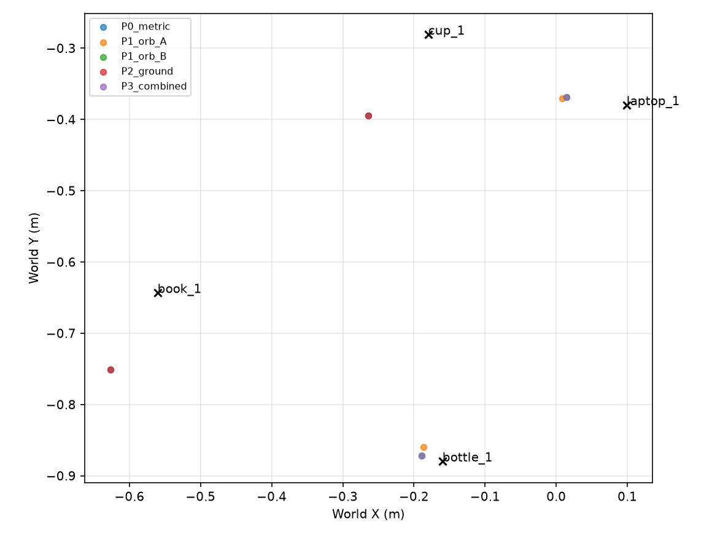
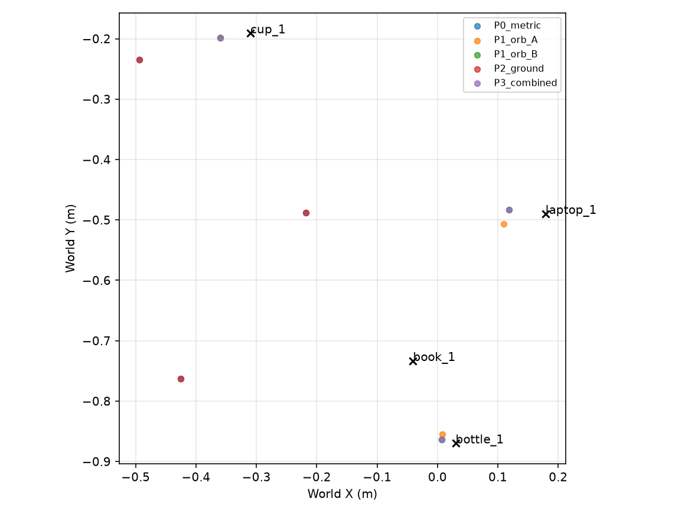

# Kitchen 360° với 18 góc, ORB và depth dự phòng

**FAIL mục tiêu hệ thống.** ORB kết hợp fallback giảm XY trung vị từ 42.4 xuống 5.7 cm ở development và từ 39.7 xuống 5.1 cm ở holdout. P3 xác nhận 2/4 và 3/4 vật tương ứng, dưới ngưỡng 80%. Thời gian quét ROS cải thiện nhờ lịch 18×1. Các nhánh ORB và tăng tốc được đo offline.

## Góc quét và đối chứng

| Cấu hình | Đúng / thấy | Confirmed | XY trung vị (cm) | ROS thực (s) | Replay (s) |
| --- | --- | --- | --- | --- | --- |
| ROS 8x3 prior | 12/21 | 3/4 | 38.7 | 180.1 | — |
| ROS 36x1 prior | 20/30 | 3/4 | 37.7 | 308.5 | — |
| Equal_12 | 7/9 | 0/4 | KHÔNG CÓ KẾT QUẢ | NOT TESTED | 1.20 |
| Equal_18 | 10/16 | 2/4 | 41.1 | NOT TESTED | 1.74 |
| Equal_36 | 20/30 | 3/4 | 37.7 | NOT TESTED | 2.64 |
| ROS 18×1 mới | 10/16 | 2/4 | 42.4 | 163.2 | — |

| Hệ thống | Recall | XY trung vị / P90 (cm) | ROS (s) | Mục tiêu |
| --- | --- | --- | --- | --- |
| Production 8×3 | 75.0% | 38.7 / 43.6 | 180.1 | FAIL |
| Production 36×1 | 75.0% | 37.7 / 45.1 | 308.5 | FAIL |
| 18×1 Metric3D | 50.0% | 42.4 / 47.2 | 163.2 | FAIL |
| 18×1 P3 development | 50.0% | 5.7 / 7.9 | NOT TESTED | FAIL |
| 18×1 P3 holdout | 75.0% | 5.1 / 5.9 | NOT TESTED | FAIL |

18×1 development nhanh hơn 8×3 16.8 s và 36×1 145.3 s. Recall giảm từ 3/4 còn 2/4. Cốc có hai observations và sách có một observation bị cắt biên. Production cần ba observations và ít nhất một observation nguyên khung. 18×2 là phép thử tùy chọn, NOT TESTED trong batch này. Lặp ảnh ở cùng góc có thể thêm số quan sát cho cốc nhưng chưa chứng minh sẽ tạo góc thấy sách nguyên vẹn.

Dùng lại các kết quả 8×3 và 36×1 đã lưu để so thời gian. YOLOE/depth tương ứng 14,4/106,9 s và 18,6/155,1 s. Các tập 12/18/36 replay lấy mỗi stop thứ 3/2/1 của bộ 36×1. Mốc 8×3 có ba frame cùng góc, vì vậy detection recall theo frame có mẫu số khác.

[So sánh số góc](angle_subset_comparison.csv) · [Baseline multiview](../multiview_36deg_geometry_fullbatch_20261110_231819/REPORT.md) · [Đánh giá ba world](../metric3d_crossworld_fullbatch_20261110_222348/REPORT.md)

## Thiết lập và tính độc lập

Đọc code RunScan, perception, association, SQLite, batch 36 góc và cross-world. Tìm theo tên nhưng chưa thấy tệp Consensus tùy chọn. Development dùng scene 36×1 giống từng byte. Holdout chỉ dời XY bốn vật. Camera 1280×720, HFOV 70°, fx = fy = 914,015 px, cx = 640 và cy = 360, camera cao 1,10 m. Đo yaw bằng TF/joint và dùng CameraInfo theo stamp. Mỗi stop cách 20°, settle 1,5 s. Checkpoint, prompts, ngưỡng và association dùng cấu hình đã khóa.

ORB-A dùng median các tọa độ XYZ điểm hợp lệ. ORB-B lấy median axial Z của các điểm đó và chiếu qua centroid mask RGB đã erode. Cùng công thức K/TF với production, nhưng pixel centroid không được lọc theo validity của Metric3D. Tâm mesh chỉ dùng để chấm. Sai số Z bề mặt, vị trí đại diện và vị trí gộp được tính riêng. Nhánh sàn suy độ sâu tia cắt mặt phẳng ngang từ K, camera height và TF rồi so với Metric3D để tìm tỷ lệ. P3 ưu tiên ORB-B, tiếp đến sàn hợp lệ rồi đến Metric3D gốc. GT depth và panoptic chỉ dùng để chấm hoặc chạy oracle sàn.

Code, tham số và scene holdout đã được băm trước RunScan. Holdout là một bố trí Kitchen mới với cùng vật liệu, camera và điều kiện chiếu sáng. Kết quả chỉ đại diện cho điều kiện này.

[Thiết kế](PLAN.md) · [Khóa holdout](holdout_lock.json) · [Pose holdout](holdout_18x1/layout.json)

## Development · scan_1794330990

RunScan đủ 18/18 trong **163.2 s**. YOLOE 12.0 s, Metric3D 80.0 s, hậu xử lý 1.6 s. Yaw lệch tối đa 0.093°, độ lệch stamp joint tối đa 5.0 ms. Có 40 observations. RGB phát hiện đúng 10/16 lượt thấy vật (62.5%), bỏ sót 6, sai lớp 0, cắt biên 2.

| Vật | Thấy | Đúng | Sai lớp | Bỏ sót | Cắt biên | Obs hợp lệ |
| --- | --- | --- | --- | --- | --- | --- |
| Chai | 4 | 3 | 0 | 1 | 0 | 3 |
| Cốc | 4 | 2 | 0 | 2 | 0 | 2 |
| Laptop | 4 | 4 | 0 | 0 | 1 | 4 |
| Sách | 4 | 1 | 0 | 3 | 1 | 1 |

Sai số cuối SQLite tính theo tâm mesh. Mỗi ô ghi XY / XYZ theo cm.

| Phương pháp | Chai | Cốc | Laptop | Sách | Xác nhận đúng |
| --- | --- | --- | --- | --- | --- |
| P0 Metric3D | 48.4 / 48.9 | KHÔNG CÓ KẾT QUẢ | 36.3 / 36.4 | KHÔNG CÓ KẾT QUẢ | 2/4 |
| ORB-A thuần | 3.3 / 3.9 | KHÔNG CÓ KẾT QUẢ | 9.1 / 11.0 | KHÔNG CÓ KẾT QUẢ | 2/4 |
| ORB-B thuần | 3.0 / 3.3 | KHÔNG CÓ KẾT QUẢ | 8.5 / 9.0 | KHÔNG CÓ KẾT QUẢ | 2/4 |
| P1 ORB-A + dự phòng | 3.3 / 3.9 | KHÔNG CÓ KẾT QUẢ | 9.1 / 11.0 | KHÔNG CÓ KẾT QUẢ | 2/4 |
| P1 ORB-B + dự phòng | 3.0 / 3.3 | KHÔNG CÓ KẾT QUẢ | 8.5 / 9.0 | KHÔNG CÓ KẾT QUẢ | 2/4 |
| P2 Sàn + dự phòng | 48.4 / 48.9 | KHÔNG CÓ KẾT QUẢ | 36.3 / 36.4 | KHÔNG CÓ KẾT QUẢ | 2/4 |
| P3 Kết hợp | 3.0 / 3.3 | KHÔNG CÓ KẾT QUẢ | 8.5 / 9.0 | KHÔNG CÓ KẾT QUẢ | 2/4 |
| Keyframe 40° | 52.6 / 53.2 | KHÔNG CÓ KẾT QUẢ | 37.2 / 37.3 | KHÔNG CÓ KẾT QUẢ | 2/4 |
| ORB theo nhu cầu | KHÔNG CÓ KẾT QUẢ | KHÔNG CÓ KẾT QUẢ | 20.9 / 20.9 | KHÔNG CÓ KẾT QUẢ | 1/4 |

Depth đại diện so với axial GT của vùng hợp lệ. Cột cuối tính vị trí SQLite với ngưỡng ghép đúng instance và XY ≤50 cm. Precision chỉ tính vật thuộc phạm vi nhãn.

| Nhánh | n depth | MAE / bias Z (cm) | AbsRel | XY trung vị / P90 (cm) | XYZ trung vị (cm) | Precision | Sai lớp / Trùng / Ngoài phạm vi | Trong 50 cm |
| --- | --- | --- | --- | --- | --- | --- | --- | --- |
| P0 Metric3D | 10 | 27.9 / -27.9 | 22.2% | 42.4 / 47.2 | 42.7 | 100.0% | 0 / 0 / 3 | 2 |
| ORB-A thuần | 9 | 3.3 / -2.6 | 2.4% | 6.2 / 8.5 | 7.4 | 100.0% | 0 / 0 / 0 | 2 |
| ORB-B thuần | 9 | 3.3 / -2.5 | 2.4% | 5.7 / 7.9 | 6.1 | 100.0% | 0 / 0 / 0 | 2 |
| P1 ORB-A + dự phòng | 10 | 5.0 / -4.4 | 4.6% | 6.2 / 8.5 | 7.4 | 100.0% | 0 / 0 / 3 | 2 |
| P1 ORB-B + dự phòng | 10 | 5.0 / -4.3 | 4.6% | 5.7 / 7.9 | 6.1 | 100.0% | 0 / 0 / 3 | 2 |
| P2 Sàn + dự phòng | 10 | 27.9 / -27.9 | 22.2% | 42.4 / 47.2 | 42.7 | 100.0% | 0 / 0 / 3 | 2 |
| P3 Kết hợp | 10 | 5.0 / -4.3 | 4.6% | 5.7 / 7.9 | 6.1 | 100.0% | 0 / 0 / 3 | 2 |
| Keyframe 40° | 8 | 32.0 / -32.0 | 24.6% | 44.9 / 51.1 | 45.2 | 100.0% | 0 / 0 / 3 | 1 |
| ORB theo nhu cầu | 10 | 12.6 / -12.0 | 10.3% | 20.9 / 20.9 | 20.9 | 100.0% | 0 / 0 / 3 | 1 |

### ORB và mặt sàn

ORB dùng RGB trong mask YOLOE, K và TF. Camera lệch trục pan 5.0 cm theo TF. Có 10 cặp cùng lớp được thử, 9 cặp đạt. 545 điểm qua gate cặp, 514 điểm đối chiếu được với GT của cùng instance trong cả hai ảnh. Mất 0.588 s để chạy ghép/tam giác hóa offline. Các cặp không đạt và lý do nằm trong CSV.

| Vật | Cặp đạt / thử | Match | Điểm 3D qua gate cặp | Điểm chấm | Sai số Z bề mặt trung vị / P90 (cm) | Đại diện ORB / detection đúng |
| --- | --- | --- | --- | --- | --- | --- |
| Chai | 3/3 | 149 | 138 | 135 | 4.2 / 12.5 | 3/3 |
| Cốc | 1/1 | 195 | 194 | 191 | 2.4 / 11.1 | 2/2 |
| Laptop | 5/6 | 233 | 213 | 188 | 4.9 / 16.8 | 4/4 |
| Sách | 0/0 | 0 | 0 | 0 | KHÔNG CÓ KẾT QUẢ / KHÔNG CÓ KẾT QUẢ | 0/1 |

Sai số vị trí đại diện theo từng ảnh trước khi gộp. Mỗi ô ghi trung vị XY / XYZ theo cm.

| Nhánh | Số vị trí chấm | XY / XYZ |
| --- | --- | --- |
| P0 Metric3D | 10 | 32.5 / 32.6 |
| ORB-A thuần | 9 | 6.8 / 6.8 |
| ORB-B thuần | 9 | 6.8 / 6.9 |
| P3 Kết hợp | 10 | 7.2 / 7.5 |

Đối chứng trên đúng các detection mà cả ba cách đo đều có vị trí. Các ô là trung vị XY / XYZ (cm).

| Vật | Số cặp | Metric3D | ORB-A | ORB-B |
| --- | --- | --- | --- | --- |
| Chai | 3 | 46.1 / 46.6 | 3.5 / 3.6 | 2.8 / 3.1 |
| Cốc | 2 | 20.7 / 21.1 | 6.8 / 6.8 | 6.7 / 6.8 |
| Laptop | 4 | 33.8 / 33.8 | 9.1 / 11.6 | 9.1 / 9.7 |
| Sách | 0 | KHÔNG CÓ KẾT QUẢ | KHÔNG CÓ KẾT QUẢ | KHÔNG CÓ KẾT QUẢ |

Sàn RGB qua gate 0/18 ảnh. Có 4/18 ảnh có pixel sàn GT trong vùng kiểm tra. Oracle dùng mask sàn GT qua gate 4/18. Oracle chỉ dùng để phân biệt thiếu hình ảnh sàn với lỗi khâu nhận diện sàn RGB. P3 chọn nguồn ORB 9, METRIC3D 31. Ground ghi lý do từ chối cho từng frame. Bảng hiệu chỉnh ghi kết quả đối chứng P0/P2 của cùng observation.

P3 giảm XY trung vị sau SQLite 36.6 cm so với P0. Chênh lệch số vật confirmed là +0.

[Detection theo góc](scan_18x1/detection_by_angle.csv) · [ORB pairs](scan_18x1/orb_pairs.csv) · [Điểm 3D](scan_18x1/orb_points.csv) · [ORB đại diện](scan_18x1/orb_object_localization.csv) · [Sai số từng observation](scan_18x1/object_observation_scores.csv) · [Sàn](scan_18x1/ground_plane_feasibility.csv) · [Hiệu chỉnh sàn](scan_18x1/ground_plane_correction.csv) · [Fallback](scan_18x1/fallback_trace.csv) · [K/TF/yaw](scan_18x1/capture_audit.csv) · [Pose scene](scan_18x1/pose_check.json) · [RunScan](scan_18x1/action.log)



[18 khung RGB](scan_18x1/all_stops.jpg) · [Minh họa ghép ORB](scan_18x1/orb_matches.jpg)

### Tiết kiệm Metric3D

| Nhánh | Lượt Metric3D | Depth ước tính (s) | ORB CPU (s) | Sàn CPU (s) | Replay SQLite/query (s) | Confirmed |
| --- | --- | --- | --- | --- | --- | --- |
| P0 Metric3D | 18 | 80.0 | 0.000 | 0.000 | 1.303 | 2/4 |
| P3 Kết hợp | 18 | 80.0 | 0.588 | 2.534 | 1.297 | 2/4 |
| Keyframe 40° | 9 | 41.2 | 0.000 | 0.000 | 0.902 | 2/4 |
| ORB theo nhu cầu | 8 | 34.0 | 0.588 | 2.534 | 1.318 | 1/4 |

Keyframe tái sử dụng 6 vị trí. P90 tuổi dữ liệu tái sử dụng 6.1 s sim. Có 0 lần được xác định là chuyển sai instance. Các lượt thiếu nhãn nằm riêng trong trace. Vị trí tái dùng được tính như observation trong replay, nên phải đọc cùng số lần đo mới và số góc trong JSON.

Nhánh theo nhu cầu bỏ Metric3D ở 10 ảnh không có detection và 0 ảnh có detection đã được ORB từ ảnh trước giải quyết hết. Sàn vẫn cần depth hiện tại. Chi phí ORB dùng thời gian của toàn bộ phép thử cặp đã chạy. Thời gian tiết kiệm lấy tổng thời gian inference đã ghi trên các frame tương ứng. End-to-end ROS của các nhánh tăng tốc là NOT TESTED.

[Runtime](scan_18x1/runtime.csv) · [Lịch gọi depth](scan_18x1/depth_schedule.csv) · [Keyframe trace](scan_18x1/key40_trace.csv) · [JSON kết quả](scan_18x1/experiment_summary.json)

## Holdout · scan_1794331404

RunScan đủ 18/18 trong **160.8 s**. YOLOE 12.1 s, Metric3D 79.4 s, hậu xử lý 1.4 s. Yaw lệch tối đa 0.085°, độ lệch stamp joint tối đa 7.0 ms. Có 39 observations. RGB phát hiện đúng 9/17 lượt thấy vật (52.9%), bỏ sót 8, sai lớp 0, cắt biên 0.

| Vật | Thấy | Đúng | Sai lớp | Bỏ sót | Cắt biên | Obs hợp lệ |
| --- | --- | --- | --- | --- | --- | --- |
| Chai | 4 | 3 | 0 | 1 | 0 | 3 |
| Cốc | 4 | 3 | 0 | 1 | 0 | 3 |
| Laptop | 5 | 3 | 0 | 2 | 0 | 3 |
| Sách | 4 | 0 | 0 | 4 | 0 | 0 |

Sai số cuối SQLite tính theo tâm mesh. Mỗi ô ghi XY / XYZ theo cm.

| Phương pháp | Chai | Cốc | Laptop | Sách | Xác nhận đúng |
| --- | --- | --- | --- | --- | --- |
| P0 Metric3D | 46.8 / 47.1 | 18.9 / 19.4 | 39.7 / 39.8 | KHÔNG CÓ KẾT QUẢ | 3/4 |
| ORB-A thuần | 2.7 / 3.2 | 5.1 / 5.1 | 7.2 / 10.3 | KHÔNG CÓ KẾT QUẢ | 3/4 |
| ORB-B thuần | 2.4 / 2.7 | 5.1 / 5.2 | 6.1 / 7.4 | KHÔNG CÓ KẾT QUẢ | 3/4 |
| P1 ORB-A + dự phòng | 2.7 / 3.2 | 5.1 / 5.1 | 7.2 / 10.3 | KHÔNG CÓ KẾT QUẢ | 3/4 |
| P1 ORB-B + dự phòng | 2.4 / 2.7 | 5.1 / 5.2 | 6.1 / 7.4 | KHÔNG CÓ KẾT QUẢ | 3/4 |
| P2 Sàn + dự phòng | 46.8 / 47.1 | 18.9 / 19.4 | 39.7 / 39.8 | KHÔNG CÓ KẾT QUẢ | 3/4 |
| P3 Kết hợp | 2.4 / 2.7 | 5.1 / 5.2 | 6.1 / 7.4 | KHÔNG CÓ KẾT QUẢ | 3/4 |
| Keyframe 40° | 55.4 / 55.9 | 22.3 / 22.9 | KHÔNG CÓ KẾT QUẢ | KHÔNG CÓ KẾT QUẢ | 2/4 |
| ORB theo nhu cầu | 16.1 / 16.1 | 14.2 / 14.6 | KHÔNG CÓ KẾT QUẢ | KHÔNG CÓ KẾT QUẢ | 2/4 |

Depth đại diện so với axial GT của vùng hợp lệ. Cột cuối tính vị trí SQLite với ngưỡng ghép đúng instance và XY ≤50 cm. Precision chỉ tính vật thuộc phạm vi nhãn.

| Nhánh | n depth | MAE / bias Z (cm) | AbsRel | XY trung vị / P90 (cm) | XYZ trung vị (cm) | Precision | Sai lớp / Trùng / Ngoài phạm vi | Trong 50 cm |
| --- | --- | --- | --- | --- | --- | --- | --- | --- |
| P0 Metric3D | 9 | 27.6 / -27.6 | 20.0% | 39.7 / 45.4 | 39.8 | 100.0% | 0 / 0 / 3 | 3 |
| ORB-A thuần | 9 | 1.3 / -0.3 | 0.9% | 5.1 / 6.7 | 5.1 | 100.0% | 0 / 0 / 0 | 3 |
| ORB-B thuần | 9 | 1.3 / -0.1 | 1.0% | 5.1 / 5.9 | 5.2 | 100.0% | 0 / 0 / 0 | 3 |
| P1 ORB-A + dự phòng | 9 | 1.3 / -0.3 | 0.9% | 5.1 / 6.7 | 5.1 | 100.0% | 0 / 0 / 3 | 3 |
| P1 ORB-B + dự phòng | 9 | 1.3 / -0.1 | 1.0% | 5.1 / 5.9 | 5.2 | 100.0% | 0 / 0 / 3 | 3 |
| P2 Sàn + dự phòng | 9 | 27.6 / -27.6 | 20.0% | 39.7 / 45.4 | 39.8 | 100.0% | 0 / 0 / 3 | 3 |
| P3 Kết hợp | 9 | 1.3 / -0.1 | 1.0% | 5.1 / 5.9 | 5.2 | 100.0% | 0 / 0 / 3 | 3 |
| Keyframe 40° | 8 | 33.0 / -33.0 | 24.1% | 38.8 / 52.1 | 39.4 | 100.0% | 0 / 0 / 2 | 1 |
| ORB theo nhu cầu | 9 | 10.8 / -9.7 | 7.7% | 15.1 / 15.9 | 15.4 | 100.0% | 0 / 0 / 3 | 2 |

### ORB và mặt sàn

ORB dùng RGB trong mask YOLOE, K và TF. Camera lệch trục pan 5.0 cm theo TF. Có 9 cặp cùng lớp được thử, 9 cặp đạt. 660 điểm qua gate cặp, 639 điểm đối chiếu được với GT của cùng instance trong cả hai ảnh. Mất 0.584 s để chạy ghép/tam giác hóa offline. Các cặp không đạt và lý do nằm trong CSV.

| Vật | Cặp đạt / thử | Match | Điểm 3D qua gate cặp | Điểm chấm | Sai số Z bề mặt trung vị / P90 (cm) | Đại diện ORB / detection đúng |
| --- | --- | --- | --- | --- | --- | --- |
| Chai | 3/3 | 207 | 192 | 189 | 5.4 / 16.5 | 3/3 |
| Cốc | 3/3 | 308 | 295 | 291 | 3.1 / 9.5 | 3/3 |
| Laptop | 3/3 | 193 | 173 | 159 | 5.4 / 16.4 | 3/3 |
| Sách | 0/0 | 0 | 0 | 0 | KHÔNG CÓ KẾT QUẢ / KHÔNG CÓ KẾT QUẢ | 0/0 |

Sai số vị trí đại diện theo từng ảnh trước khi gộp. Mỗi ô ghi trung vị XY / XYZ theo cm.

| Nhánh | Số vị trí chấm | XY / XYZ |
| --- | --- | --- |
| P0 Metric3D | 9 | 34.4 / 34.6 |
| ORB-A thuần | 9 | 4.8 / 4.9 |
| ORB-B thuần | 9 | 4.8 / 4.9 |
| P3 Kết hợp | 9 | 4.8 / 4.9 |

Đối chứng trên đúng các detection mà cả ba cách đo đều có vị trí. Các ô là trung vị XY / XYZ (cm).

| Vật | Số cặp | Metric3D | ORB-A | ORB-B |
| --- | --- | --- | --- | --- |
| Chai | 3 | 35.0 / 35.2 | 3.6 / 3.9 | 3.1 / 3.3 |
| Cốc | 3 | 17.4 / 17.9 | 4.8 / 4.9 | 4.8 / 4.9 |
| Laptop | 3 | 44.2 / 44.4 | 7.1 / 10.2 | 5.6 / 6.9 |
| Sách | 0 | KHÔNG CÓ KẾT QUẢ | KHÔNG CÓ KẾT QUẢ | KHÔNG CÓ KẾT QUẢ |

Sàn RGB qua gate 0/18 ảnh. Có 4/18 ảnh có pixel sàn GT trong vùng kiểm tra. Oracle dùng mask sàn GT qua gate 4/18. Oracle chỉ dùng để phân biệt thiếu hình ảnh sàn với lỗi khâu nhận diện sàn RGB. P3 chọn nguồn METRIC3D 30, ORB 9. Ground ghi lý do từ chối cho từng frame. Bảng hiệu chỉnh ghi kết quả đối chứng P0/P2 của cùng observation.

P3 giảm XY trung vị sau SQLite 34.6 cm so với P0. Chênh lệch số vật confirmed là +0.

[Detection theo góc](holdout_18x1/detection_by_angle.csv) · [ORB pairs](holdout_18x1/orb_pairs.csv) · [Điểm 3D](holdout_18x1/orb_points.csv) · [ORB đại diện](holdout_18x1/orb_object_localization.csv) · [Sai số từng observation](holdout_18x1/object_observation_scores.csv) · [Sàn](holdout_18x1/ground_plane_feasibility.csv) · [Hiệu chỉnh sàn](holdout_18x1/ground_plane_correction.csv) · [Fallback](holdout_18x1/fallback_trace.csv) · [K/TF/yaw](holdout_18x1/capture_audit.csv) · [Pose scene](holdout_18x1/pose_check.json) · [RunScan](holdout_18x1/action.log)



[18 khung RGB](holdout_18x1/all_stops.jpg) · [Minh họa ghép ORB](holdout_18x1/orb_matches.jpg)

### Tiết kiệm Metric3D

| Nhánh | Lượt Metric3D | Depth ước tính (s) | ORB CPU (s) | Sàn CPU (s) | Replay SQLite/query (s) | Confirmed |
| --- | --- | --- | --- | --- | --- | --- |
| P0 Metric3D | 18 | 79.4 | 0.000 | 0.000 | 1.480 | 3/4 |
| P3 Kết hợp | 18 | 79.4 | 0.584 | 2.425 | 1.451 | 3/4 |
| Keyframe 40° | 9 | 40.4 | 0.000 | 0.000 | 0.970 | 2/4 |
| ORB theo nhu cầu | 8 | 33.9 | 0.584 | 2.425 | 1.423 | 2/4 |

Keyframe tái sử dụng 6 vị trí. P90 tuổi dữ liệu tái sử dụng 6.2 s sim. Có 0 lần được xác định là chuyển sai instance. Các lượt thiếu nhãn nằm riêng trong trace. Vị trí tái dùng được tính như observation trong replay, nên phải đọc cùng số lần đo mới và số góc trong JSON.

Nhánh theo nhu cầu bỏ Metric3D ở 10 ảnh không có detection và 0 ảnh có detection đã được ORB từ ảnh trước giải quyết hết. Sàn vẫn cần depth hiện tại. Chi phí ORB dùng thời gian của toàn bộ phép thử cặp đã chạy. Thời gian tiết kiệm lấy tổng thời gian inference đã ghi trên các frame tương ứng. End-to-end ROS của các nhánh tăng tốc là NOT TESTED.

[Runtime](holdout_18x1/runtime.csv) · [Lịch gọi depth](holdout_18x1/depth_schedule.csv) · [Keyframe trace](holdout_18x1/key40_trace.csv) · [JSON kết quả](holdout_18x1/experiment_summary.json)

## Kiểm tra và kết luận

| Hạng mục | Trạng thái | Bằng chứng |
| --- | --- | --- |
| 18 quartet RGB/depth/panoptic/CameraInfo mỗi lượt, K, TF, yaw | PASS | Replay strict và capture_audit.csv của cả hai lượt |
| P0 khớp SQLite live, truy vấn và confidence | PASS | So hàng SQLite, xác minh conf_sum, conf_mean, radius, nearest, approach và foreign key |
| Hình học/triangulation/fallback | PASS | 4 diagnostic tests, gồm trường hợp thiếu dữ liệu |
| LOC3D và YOLOE regression | PASS | 59 LOC3D, 79 YOLOE |
| Sàn RGB Kitchen | FAIL | Development 0/18, holdout 0/18 ảnh có scale hợp lệ |
| Recall confirmed ≥80% | FAIL | P3 2/4 và 3/4 |
| P3 và nhánh tăng tốc end-to-end ROS | NOT TESTED | Chỉ P0 chạy ROS, các nhánh còn lại dùng replay |

1. **18 góc** tiết kiệm thời gian quét, đồng thời mất một vật confirmed so với 8×3 và 36×1 ở development.
2. **ORB** cải thiện định vị cả vật đã confirmed trên các bố trí thử; độ phủ xem bảng theo vật.
3. **Vị trí ORB-B** sau SQLite có XY/XYZ trung vị 5.7/6.1 cm ở development và 5.1/5.2 cm ở holdout. Các lỗi bề mặt và từng ảnh nằm ở bảng trên.
4. **Mặt sàn RGB** dùng được ở 0/18 và 0/18 ảnh. Kết quả AWS trước đây (AbsRel 25,8% → 8,5%) chỉ cung cấp đối chứng ngoài Kitchen.
5. **Kết hợp** không tăng độ phủ so với ORB + fallback khi không có sàn đạt gate. So sánh ORB thuần và P3 trong bảng cho thấy chính xác các vật có thể xác nhận.
6. **Fallback** đi đúng nhánh khi ORB/sàn thiếu hỗ trợ. Metric3D giữ vai trò đo dự phòng và vẫn mang bias đã đo.
7. **Đủ 4/4** chưa đạt.
8. **Tốc độ thật** có cải thiện khi đổi lịch quét. Tác động latency của P3, keyframe và nhánh theo nhu cầu vẫn cần đo ROS.
9. **Holdout** tái hiện mức giảm XY trung vị 34.6 cm của P3, trên 3/4 vật confirmed.
10. **Production** chưa đạt tiêu chí để đưa P3 vào. Bước tiếp theo có căn cứ nhất là thử lịch lấy thêm các góc thấy cốc/sách nguyên khung, rồi kiểm tra có đủ ba observations mỗi vật trước khi tối ưu số lần gọi Metric3D.

JSON kết quả có trường `scan` mang tên nhánh cuối do biến vòng lặp. Dùng trường `id`, đường dẫn thư mục và action log để nhận diện lượt quét. Giữ nguyên mã đã khóa.

## Lệnh và dữ liệu

Các lệnh dưới đây chạy từ `/mnt/d/loc3d_ws` trong WSL, trừ YOLOE tests chạy ở `D:\yoloe_test` trong PowerShell. `$b` là thư mục batch.

```bash
b="$PWD/data/eval/orb_ground_18angle_fullbatch_20261111_001408"
.venv/bin/python "$b/prepare_scan.py" "$b" scan_18x1
bash "$b/capture.sh" scan_18x1
.venv/bin/python "$b/experiment.py" subset
.venv/bin/python "$b/experiment.py" scan_18x1
bash "$b/run_holdout.sh"
# run_ready.sh calls this in each native scan:
ros2 action send_goal /scan/run scan_interfaces/action/RunScan '{step_deg: 20.0, frames_per_stop: 1, settle_time_s: 1.5}' --feedback
# run_holdout.sh runs both diagnostic tests and the LOC3D suite:
.venv/bin/python "$b/test_diagnostic.py"
.venv/bin/python -m pytest -q -s -p no:cacheprovider --basetemp="$b/tmp/pytest" tests
.venv/bin/python "$b/write_report.py"
.venv/bin/python "$b/verify_batch.py"
```

```powershell
.\.venv\Scripts\python.exe -m unittest discover -s tests
```

[LOC3D log](regression_loc3d.log) · [YOLOE log](regression_yoloe.log) · [Diagnostic log](regression_diagnostic.log) · [Manifest](manifest.sha256) · [Hash 36 frame local](raw_frames.sha256) · [Phạm vi Git](PUBLISHED.md)

Đầu ra mới gồm script thử nghiệm, SDF và cấu hình hai scene thử, dữ liệu đồng bộ, SQLite live/replay, ảnh, bảng CSV/JSON và log. Git lưu snapshot chấm và mã, các NPZ dung lượng lớn lưu tại workspace. Xem PUBLISHED.md để tái chạy.
